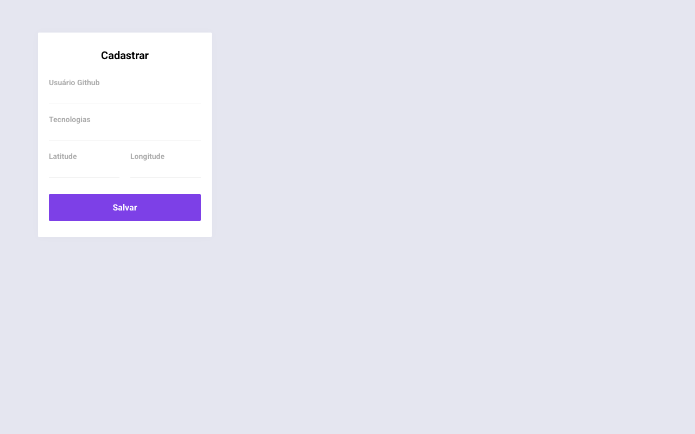

# 📍 Findev

Plataforma para **encontrar desenvolvedores por tecnologia e proximidade**: o dev se cadastra com usuário do GitHub, tecnologias e localização, e outras pessoas podem buscar por stack dentro de um raio. Construído durante a **Semana OmniStack 10 (Rocketseat)**.



## Estrutura (monorepo)

| Pasta | Stack |
| --- | --- |
| [`backend/`](backend) | Node.js, Express, Mongoose (MongoDB), Socket.IO |
| [`frontend/`](frontend) | React, Axios |
| [`mobile/`](mobile) | React Native (Expo), Expo Location, React Native Maps |

## Endpoints da API

| Método | Rota | Descrição |
| --- | --- | --- |
| `GET` | `/devs` | Lista os devs cadastrados |
| `POST` | `/devs` | Cadastra um dev (dados importados do GitHub) |
| `GET` | `/search` | Busca devs por tecnologias e raio de distância |

## Como rodar

Requer Node.js e uma instância MongoDB (ajuste a string de conexão em `backend/src/index.js`).

```bash
cd backend && npm install && npm run dev
cd frontend && npm install && npm start
cd mobile && npm install && npm start
```

## Autor

Feito por [Amós Magalhães](https://github.com/amslimaa).
